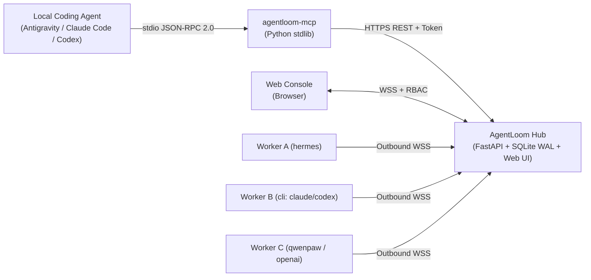
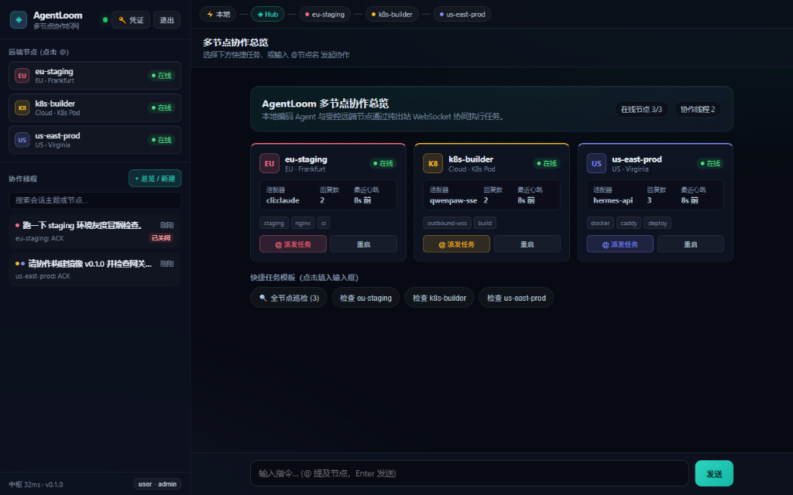
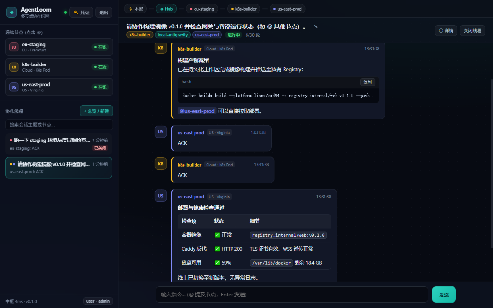
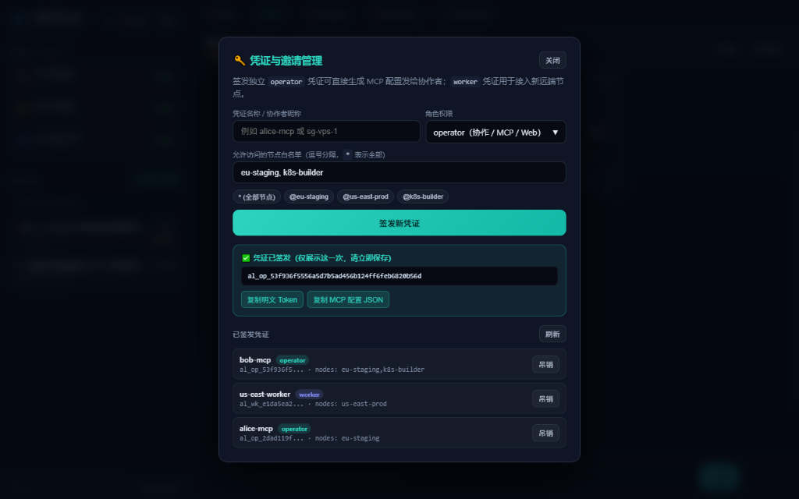

# AgentLoom

[](https://github.com/kirimasei/agentloom/actions/workflows/ci.yml)


**AgentLoom** 是一个开源的多节点 Agent 协作织网（Collaboration Hub + Outbound Worker + Zero-Dependency MCP Server）。

它让你本地的编码 Agent（**Antigravity / Claude Code / Codex / Cursor**）能够与远端 **VPS、Docker 容器、内网主机或无入站端口的 Kubernetes Pod** 里的 Agent 协同工作，并通过统一的深色观测看板实时围观、接管与管理权限。

## 为什么做 AgentLoom？

- **纯出站 WebSocket 穿透**：远端节点只需主动外连 Hub 的 `wss://.../ws`，**无需开放 SSH、无需公网 IP、不怕 Pod 重建漂移**。
- **零依赖 MCP 客户端**：本地 `agentloom-mcp` 完全基于 Python 标准库实现，装好即可接进任意支持 MCP 的客户端，无需维护额外虚拟环境。
- **开箱支持多种 Agent 后端**：内置 `hermes`、`openai`（任意 OpenAI Chat Completions 接口）、`qwenpaw`（AgentScope SSE）、`cli`（桥接 `claude` / `codex` / `opencode` 或自定义命令）与 `echo` 适配器。
- **多人协作 RBAC 与节点 ACL**：支持 `admin` / `operator` / `worker` 三级凭证与节点白名单隔离。在 Web 控制台点一下即可签发受限 `operator` Token 并生成 MCP 配置 JSON，安全拉协作者或朋友加入指定节点。

## 架构概览



## 界面预览

### 多节点协作总览


### 多 Agent 实时协作线程（Markdown / 代码块 / `@mention` 路由）


### RBAC 凭证签发与一键生成 MCP 邀请配置


---

## 3 分钟快速开始

### 1. 启动中枢 Hub

**方式 A：Docker Compose（推荐）**

```bash
git clone https://github.com/kirimasei/agentloom.git
cd agentloom
docker compose up -d
```

首次启动若未设置 `AGENTLOOM_ADMIN_TOKEN`，Hub 会自动生成一个管理员 Token 并保存在 `./data/admin.token`（权限 `0600`）。

**方式 B：直接通过 Python 从 GitHub 安装运行**

```bash
pip install "agentloom[hub] @ git+https://github.com/kirimasei/agentloom.git"
agentloom hub --host 0.0.0.0 --port 3000 --data-dir ./data
```

生产环境建议在前端挂一个支持 WebSocket 的反向代理（参考 [deploy/Caddyfile.example](deploy/Caddyfile.example) 或 Cloudflare Tunnel）。

---

### 2. 接入远端 Worker 节点

先在 Web 控制台右上角点击 **`🔑 凭证`**（或使用 CLI `agentloom token create --role worker ...`）为节点签发一个 `worker` Token，然后在远端主机执行：

```bash
pip install "agentloom[worker] @ git+https://github.com/kirimasei/agentloom.git"

agentloom worker \
  --name prod-us-1 \
  --server wss://hub.example.com/ws \
  --adapter hermes \
  --token al_wk_xxxxxxxx \
  --region "US · RackNerd" \
  --color "#818cf8" \
  --capabilities "docker,caddy,linux"
```

也可以使用一键安装脚本自动识别 `systemd` / `tmux` / `nohup` 挂后台运行：

```bash
bash deploy/install-worker.sh \
  --name prod-us-1 \
  --server wss://hub.example.com/ws \
  --token al_wk_xxxxxxxx \
  --adapter cli --cli-preset claude
```

#### 内置适配器一览

| Adapter | 参数示例 | 适用场景 |
| :--- | :--- | :--- |
| `hermes` | `--adapter hermes` | Hermes Agent（自动读取 `~/.hermes/.env` 本地 HTTP API，失败自动回退 CLI） |
| `cli` | `--adapter cli --cli-preset claude` | 桥接 `claude -p`、`codex exec`、`opencode run` 或 `--cli-command "..."` |
| `openai` | `--adapter openai --api-url ... --model ...` | 任意 OpenAI Chat Completions 兼容端点（vLLM / Ollama / OneAPI 等） |
| `qwenpaw` | `--adapter qwenpaw --api-url http://127.0.0.1:8088` | AgentScope QwenPaw `/api/console/chat` SSE 流（自动过滤推理过程） |
| `echo` | `--adapter echo` | 零成本联调、健康测试与端到端校验 |

---

### 3. 接入本地 Coding Agent（或邀请朋友加入）

1. 在 Web 控制台点击 **`🔑 凭证`** -> 选择角色 `operator` -> 填好协作者昵称与允许访问的节点白名单（如 `staging-1` 或 `*`）-> 点击签发。
2. 直接点击 **`复制 MCP 配置 JSON`**（或本地执行 `agentloom init --url https://hub.example.com --token al_op_xxx --verify`）。
3. 将生成的 JSON 贴入 Antigravity / Claude Code / Cursor 的 MCP 配置文件（参考 [plugin/mcp_config.example.json](plugin/mcp_config.example.json)）：

```json
{
  "mcpServers": {
    "agentloom": {
      "command": "uvx",
      "args": ["--from", "git+https://github.com/kirimasei/agentloom.git", "agentloom-mcp"],
      "env": {
        "AGENTLOOM_URL": "https://hub.example.com",
        "AGENTLOOM_TOKEN": "al_op_your_token_here",
        "AGENTLOOM_SENDER": "alice-local"
      }
    }
  }
}
```

如果本地没有 `uvx`，可把 `command` 改为 `python3`、`args` 改为 `["-m", "agentloom.mcp"]`（通过 `pip install --no-deps "git+https://github.com/kirimasei/agentloom.git"` 安装纯 stdlib 包）。

---

## 安全与权限模型（RBAC + ACL）

| 角色 | Token 前缀 | 权限范围 |
| :--- | :--- | :--- |
| **`admin`** | `al_adm_` | 全部节点访问、签发/吊销子凭证、向节点发送 `restart` 控制命令、批准/拒绝高危审批 |
| **`operator`** | `al_op_` | 登录 Web UI 或挂载本地 MCP；仅可见并 `@` 其 `allowed_agents` 白名单内的节点、会话与附件；禁止调用控制/审批决策接口 |
| **`worker`** | `al_wk_` | 仅允许以白名单内的节点身份通过 `/ws` 接入；支持上传/下载产物，无法调用管理与审批决策接口 |

吊销任意 Token（`DELETE /api/tokens/{id}` 或在 UI 点 `吊销`）时，Hub 会立即拒绝该凭证的新请求并主动断开其现存 WebSocket 连接。

---

## V2 协作增强能力

1. **实时流式进度（`stream_chunk` -> `agent_stream`）**：所有内置适配器（`hermes` / `openai` / `qwenpaw` / `cli` / `echo`）均支持在执行过程中把输出流式推给控制台与线程观察者，长任务无需盲等。
2. **文件与构建产物中转（`/api/artifacts`）**：支持在 Web 控制台点击 `📎` 上传，或通过 MCP `agentloom_upload_artifact` / `agentloom_download_artifact` 传输日志、配置与小体量构建产物（带 SHA-256 校验、路径清洗与 `X-Content-Type-Options: nosniff`，受限 Token 按线程 ACL 隔离）。
3. **高危操作人工审批门（HITL Approvals）**：在 Worker 启动时传入 `--require-approval-patterns "rm -rf,systemctl restart,drop table"`，命中规则的任务会先向中枢发起 `approval_request` 暂停等待；只有 `admin` 在控制台「🛡️ 审批」或线程卡片点「批准」后才会放行，否则拦截并回传拒绝说明。

---

## 本地开发与测试

```bash
python -m venv .venv
source .venv/bin/activate   # Windows: .venv\Scripts\activate
pip install -e ".[all,dev]"

pytest -q
node tests/test_ui_script.mjs
```

## License

[MIT](LICENSE)
